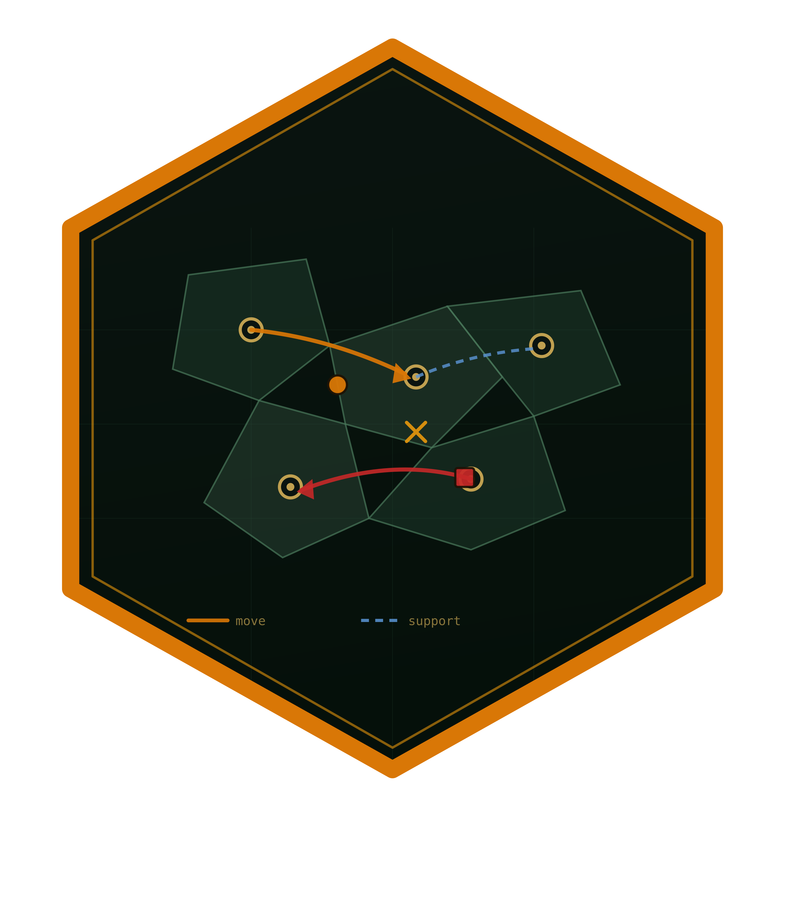

<!-- README.md is generated from README.Rmd. Please edit that file. -->

```{r setup, include = FALSE}
knitr::opts_chunk$set(
  collapse = TRUE,
  comment = "#>"
)
```

# diplomacyR 

<!-- badges: start -->
[](https://github.com/r-heller/diplomacyR/actions/workflows/R-CMD-check.yaml)
[](https://app.codecov.io/gh/r-heller/diplomacyR)
[](https://lifecycle.r-lib.org/articles/stages.html#experimental)
[](https://CRAN.R-project.org/package=diplomacyR)
<!-- badges: end -->

diplomacyR is a complete engine for the board game Diplomacy on the standard
seven-power pre-1914 map. It gives you a rules-accurate adjudicator for
simultaneous movement, the full phase machine from Spring 1901 to a solo
victory, scriptable bots, batch simulation with outcome analysis, and a
**shiny** application for interactive play.

Diplomacy has no dice. Every player writes orders for every unit in secret,
all the orders are revealed at once, and one set of rules decides what
actually happened — including the cases where the outcome of one order
depends on the outcome of another that depends back on the first. Getting
that right is what most of this package is.

## Installation

```r
# install.packages("pak")
pak::pak("r-heller/diplomacyR")
```

## A first turn

```{r example}
library(diplomacyR)

game <- dp_new_game()
game
```

Orders are written the way players write them, and resolved with
`dp_adjudicate()`. Here France attacks Burgundy with support while Germany
attacks it alone: two against one.

```{r adjudicate}
result <- dp_adjudicate(game, dp_parse_orders(c(
  "France: A Par - Bur",
  "France: A Mar S A Par - Bur",
  "Germany: A Mun - Bur"
)))

result$orders[result$orders$loc %in% c("par", "mar", "mun"), ]
```

Every power that was not ordered simply held, which is what the rules say
happens to a unit with no orders. `dp_advance()` applies the result and steps
the season, phase and year.

```{r advance}
game <- dp_advance(game, result)
game
```

To watch a whole game instead, hand it to the bots:

```{r play}
history <- dp_play(bots = "greedy", max_years = 3, seed = 1)
dp_power_summary(history)
```

## What is in the box

* **The board.** `dp_map()` loads the standard 75-province, 34-centre map
  with separate army and fleet adjacency graphs and per-coast fleet
  locations.
* **The adjudicator.** `dp_adjudicate()` resolves movement phases —
  supports, support cutting, standoffs, dislodgement, head-to-head battles,
  convoys and convoy paradoxes. `dp_retreat()` and `dp_build()` handle the
  other two phase types, and `dp_advance()` drives the season machine.
* **Orders.** `dp_parse_orders()` reads standard notation in all its usual
  spellings; `format()` renders any order set back to canonical text;
  `dp_legal_orders()` enumerates everything the rules currently permit.
* **Bots.** Four of them — `"random"`, `"hold"`, `"greedy"` and the
  experimental `"negotiator"` — through `dp_ai_orders()`, plus `dp_step()`
  and `dp_play()` to drive whole games.
* **Simulation and analysis.** `dp_simulate()` runs batches, `dp_stats()`
  and `dp_power_summary()` summarise them, and the `dp_plot_*()` functions
  return **ggplot2** objects for the board, supply-centre trajectories, win
  rates and where the fighting happens.

## Rules conformance

The adjudicator is validated against the Diplomacy Adjudicator Test Cases,
the reference suite assembled by Lucas B. Kruijswijk. It passes all 130
movement-phase cases, sections 6.A to 6.G: legality and coasts, circular
movement, supports and dislodges, head-to-head battles, convoys, convoy
paradoxes and convoying to one's own area. Where the suite allows more than
one defensible answer, the engine implements the option it marks as
preferred. The encoded cases ship with the package under `extdata/datc`.

## The application

```r
dp_run_app()
```

A **shiny** interface with an interactive board, an order editor that checks
legality as you type, a turn adjudicator, a replayable history, analysis
charts and a batch-simulation runner. It needs **shiny**, **bslib** and
**DT**, which are suggested rather than required.

## Learning more

* `vignette("diplomacyR")` — getting started.
* `vignette("notation")` — the order-notation reference.
* `vignette("adjudication")` — how a turn is resolved, worked position by
  worked position.
* `vignette("ai-and-simulation")` — bots, batch simulation and the analysis
  plots.
* `vignette("design")` — the S3 architecture, the resolver, and how coasts
  are modelled.

## Licence

MIT. Diplomacy is a trademark of its respective owners; this package is an
independent implementation of the published rules and is not affiliated with
or endorsed by them.
