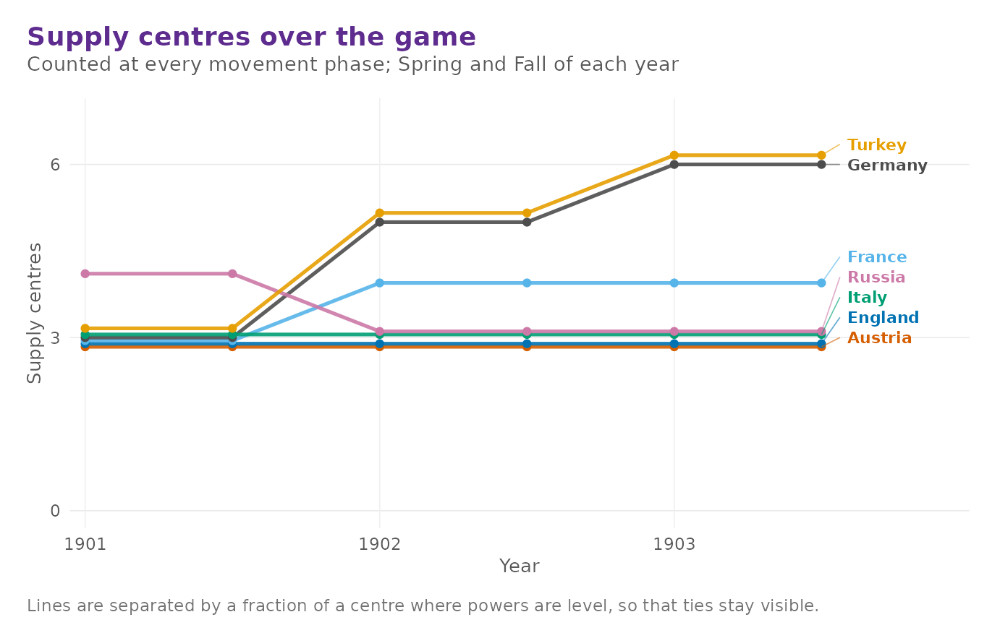
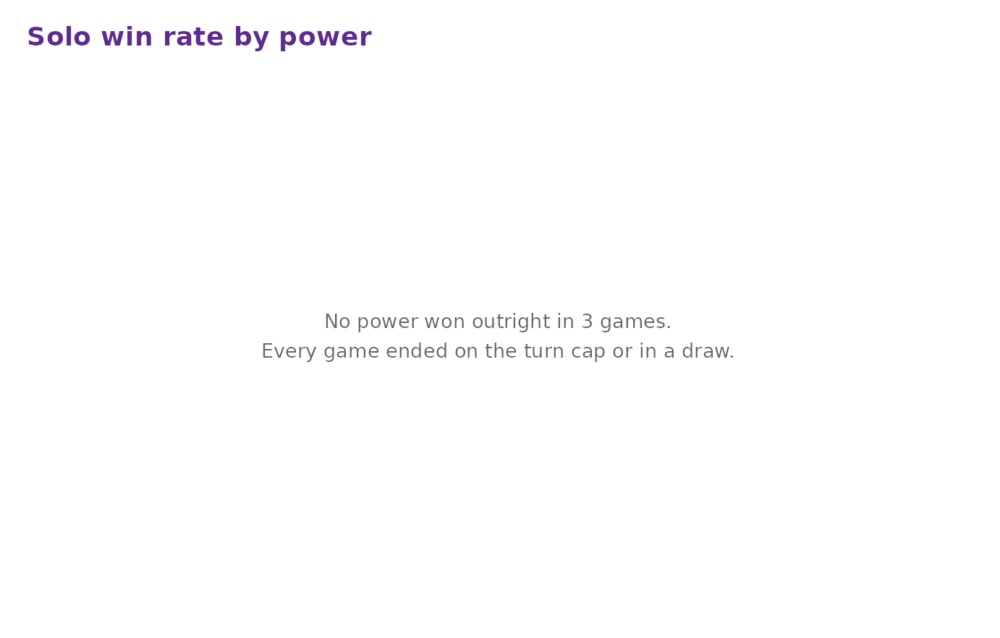
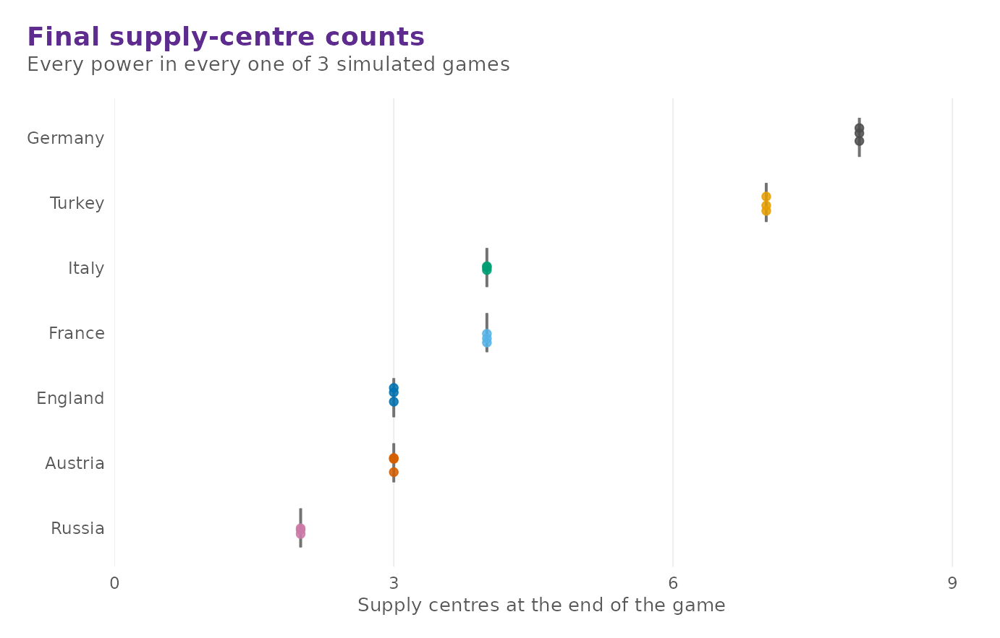
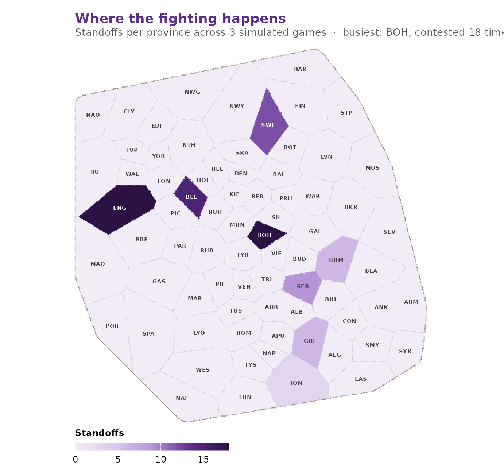

# Bots, batch simulation and analysis

``` r

library(diplomacyR)
```

Diplomacy is a negotiation game, and no program plays it well. The bots
in this package are not an attempt to change that. They exist so that a
position can be played forward without a table of seven people, so that
a rules change or a map variant can be exercised over thousands of
turns, and so that questions about the board itself — which provinces
get fought over, how long games run, whether the map is balanced — can
be answered with data rather than assertion.

## Legal orders come first

Every bot picks its orders out of
[`dp_legal_orders()`](https://r-heller.github.io/diplomacyR/reference/dp_legal_orders.md),
which enumerates exactly the orders the rules permit in the current
phase. A bot therefore cannot emit an illegal order, whatever else it
gets wrong.

``` r

game <- dp_new_game()
legal <- dp_legal_orders(game, "Italy")
table(legal$type)
#> 
#>    hold    move support 
#>       3      14      21
```

``` r

head(legal, 4)
#> <dp_orders> (4 orders)
#> Italy: F Nap H
#> Italy: F Nap - Apu
#> Italy: F Nap - Ion
#> Italy: F Nap - Rom
```

The enumeration is exhaustive, convoyed moves included, so it is also
the right thing to hand to a user interface that wants to offer a menu —
which is precisely what the bundled **shiny** order editor does.

## The four bots

[`dp_ai_orders()`](https://r-heller.github.io/diplomacyR/reference/dp_ai_orders.md)
produces a complete order set for one power.

**`"hold"`** is the passive baseline. Every unit holds; forced to act,
it retreats to the first open province, builds armies at home, and lets
the civil-disorder rule choose its disbands.

``` r

dp_ai_orders(game, "Italy", bot = "hold")
#> <dp_orders> (3 orders)
#> Italy: F Nap H
#> Italy: A Rom H
#> Italy: A Ven H
```

**`"random"`** picks uniformly among each unit’s legal orders. It is the
baseline any other strategy has to beat, and it is the useful one for
stress-testing the engine, because it generates positions no human would
ever write.

``` r

set.seed(42)
dp_ai_orders(game, "Turkey", bot = "random")
#> <dp_orders> (3 orders)
#> Turkey: F Ank - Arm
#> Turkey: A Con S A Smy
#> Turkey: A Smy S A Con - Ank
```

**`"greedy"`** walks each unit towards the nearest supply centre it does
not already own, refuses to send two of its own units to the same
province, and then converts the units with nothing better to do into
support for its own attacks. It plays a recognisable, if crude, opening.

``` r

dp_ai_orders(game, "France", bot = "greedy")
#> <dp_orders> (3 orders)
#> France: F Bre - Eng
#> France: A Mar - Spa
#> France: A Par - Bur
```

**`"negotiator"`** is greedy play plus a crude substitute for diplomacy:
it treats the board leader as the common enemy and leaves the weakest
power alone. There is no negotiation protocol in the package, so this is
a stand-in for the part of the game a program cannot play. It is marked
experimental for that reason.

``` r

dp_ai_orders(game, "Russia", bot = "negotiator")
#> <dp_orders> (4 orders)
#> Russia: A War - Gal
#> Russia: A Mos - Ukr
#> Russia: F Sev - Rum
#> Russia: F Stp/sc - Bot
```

[`dp_ai_all()`](https://r-heller.github.io/diplomacyR/reference/dp_ai_all.md)
does all seven powers at once, and takes either one bot name for
everybody or a named vector mapping powers to bots.

``` r

set.seed(3)
orders <- dp_ai_all(game, bots = c(France = "greedy", England = "random"))
orders[orders$power %in% c("England", "France"), ]
#> <dp_orders> (6 orders)
#> England: F Edi - Cly
#> England: F Lon S A Lvp - Yor
#> England: A Lvp S F Edi - Yor
#> France: F Bre - Eng
#> France: A Mar - Spa
#> France: A Par - Bur
```

Powers not named in the vector fall back to the greedy bot.

## Playing a game out

[`dp_step()`](https://r-heller.github.io/diplomacyR/reference/dp_step.md)
resolves one phase; any power you do not supply orders for is played by
`bots`.

``` r

dp_step(game, bots = "greedy")
#> <dp_game> Fall 1901 (movement phase)
#> Russia    4 centres   4 units
#> Austria   3 centres   3 units
#> England   3 centres   3 units
#> France    3 centres   3 units
#> Germany   3 centres   3 units
#> Italy     3 centres   3 units
#> Turkey    3 centres   3 units
```

[`dp_play()`](https://r-heller.github.io/diplomacyR/reference/dp_play.md)
repeats that until someone controls 18 centres, until only one power is
left, or until the turn cap. It returns a `dp_history` recording every
turn.

``` r

history <- dp_play(bots = "greedy", max_years = 3, seed = 2024)
history
#> <dp_history> (11 turns)
#> • From Spring 1901 to Winter 1903
#> • Outcome: "draw"
```

Three years is a very short game — the cap is there to keep this
vignette quick — so the outcome is a draw. The history is the
interesting part.

``` r

head(as_tibble(history), 4)
#> # A tibble: 4 × 7
#>    turn season  year phase    power   centres units
#>   <int> <chr>  <int> <chr>    <chr>     <int> <int>
#> 1     1 Spring  1901 movement Russia        4     4
#> 2     1 Spring  1901 movement Austria       3     3
#> 3     1 Spring  1901 movement England       3     3
#> 4     1 Spring  1901 movement France        3     3
```

[`dp_power_summary()`](https://r-heller.github.io/diplomacyR/reference/dp_power_summary.md)
reduces a history to one row per power, with the peak each power reached
as well as where it finished.

``` r

dp_power_summary(history)
#> # A tibble: 7 × 6
#>   power   turns start_centres final_centres peak_centres mean_centres
#>   <chr>   <int>         <int>         <int>        <int>        <dbl>
#> 1 Germany    11             3             8            8         5.27
#> 2 Turkey     11             3             7            7         5.18
#> 3 France     11             3             4            4         3.82
#> 4 Italy      11             3             4            4         3.09
#> 5 Austria    11             3             3            3         3   
#> 6 England    11             3             3            3         3   
#> 7 Russia     11             4             2            4         3.09
```

[`dp_sc_trajectory()`](https://r-heller.github.io/diplomacyR/reference/dp_sc_trajectory.md)
gives the same data restricted to movement phases, which is the natural
series to plot, and
[`dp_plot_sc_history()`](https://r-heller.github.io/diplomacyR/reference/dp_plot_sc_history.md)
plots it. The dashed line is the 18 centres a solo victory needs.

``` r

dp_plot_sc_history(history)
```



## Batch simulation

[`dp_simulate()`](https://r-heller.github.io/diplomacyR/reference/dp_simulate.md)
plays many games and collects the outcomes. It is the slow function in
the package — a full-length game is several hundred adjudications — so
keep `n` and `max_years` modest while you are exploring, and pass
`verbose = FALSE` when you do not want a line per game.

``` r

sim <- dp_simulate(
  n = 3, bots = "greedy", max_years = 3, seed = 7, verbose = FALSE
)
sim
#> <dp_sim> (3 games)
#> draw      3 (100%)
#> • Bots: "greedy"
#> • Turn cap: 3 years
```

The `dp_sim` object holds a per-game outcome table, final centre and
unit counts for every power in every game, and a tally of contested
provinces.

``` r

sim$games
#> # A tibble: 3 × 5
#>    game outcome winner years turns
#>   <int> <chr>   <chr>  <int> <int>
#> 1     1 draw    NA         4    11
#> 2     2 draw    NA         4    11
#> 3     3 draw    NA         4    11
```

[`dp_stats()`](https://r-heller.github.io/diplomacyR/reference/dp_stats.md)
summarises it three ways. `"power"` is one row per power:

``` r

dp_stats(sim, "power")
#> # A tibble: 7 × 7
#>   power   games solos win_rate survival_rate mean_centres max_centres
#>   <chr>   <int> <int>    <dbl>         <dbl>        <dbl>       <int>
#> 1 Germany     3     0        0             1            8           8
#> 2 Turkey      3     0        0             1            7           7
#> 3 France      3     0        0             1            4           4
#> 4 Italy       3     0        0             1            4           4
#> 5 Austria     3     0        0             1            3           3
#> 6 England     3     0        0             1            3           3
#> 7 Russia      3     0        0             1            2           2
```

`"outcome"` is the split between solo victories and draws, and
`"length"` the distribution of game lengths:

``` r

dp_stats(sim, "outcome")
#> # A tibble: 1 × 3
#>   outcome games share
#>   <chr>   <int> <dbl>
#> 1 draw        3     1
dp_stats(sim, "length")
#> # A tibble: 1 × 3
#>   years games share
#>   <int> <int> <dbl>
#> 1     4     3     1
```

Every game here ran into the turn cap, so both tables have a single row.
Over a real run at the default cap of twenty years they are the two
summaries you actually want.

[`summary()`](https://rdrr.io/r/base/summary.html) on a simulation is
`dp_stats(sim, "power")`, and
[`dp_power_summary()`](https://r-heller.github.io/diplomacyR/reference/dp_power_summary.md)
works on games, histories and simulations alike.

## Analysis plots

Three plot functions take a `dp_sim` directly. All of them return
**ggplot2** objects, so they can be themed, faceted or combined like any
other plot.

[`dp_plot_winrates()`](https://r-heller.github.io/diplomacyR/reference/dp_plot_winrates.md)
charts solo victories by power. Over a short run like this one there are
none to chart — a solo needs far more than three years — but over a long
run this is the balance question in one picture.

``` r

dp_plot_winrates(sim)
```



[`dp_plot_centres()`](https://r-heller.github.io/diplomacyR/reference/dp_plot_centres.md)
shows the distribution of final supply-centre counts, which says more
than the win rate does when most games end in a draw.

``` r

dp_plot_centres(sim)
```



[`dp_plot_supply_heatmap()`](https://r-heller.github.io/diplomacyR/reference/dp_plot_supply_heatmap.md)
puts the standoff tally back on the board, shading each province by how
often a move bounced there. With three short games there is almost
nothing to see; the point of the chart is the pattern that emerges over
hundreds.

``` r

dp_plot_supply_heatmap(sim)
```



## Building your own bot

There is no plug-in mechanism, and there does not need to be one. A bot
is any function that takes a game and a power and returns a `dp_orders`
tibble;
[`dp_legal_orders()`](https://r-heller.github.io/diplomacyR/reference/dp_legal_orders.md)
gives you the candidate set, and
[`dp_bind_orders()`](https://r-heller.github.io/diplomacyR/reference/dp_bind_orders.md)
assembles the answer. Here is one that holds on supply centres it
already owns and otherwise moves at random:

``` r

dig_in <- function(game, power) {
  legal <- dp_legal_orders(game, power)
  mine <- names(game$sc_owner)[game$sc_owner == power]
  on_sc <- legal$loc %in% mine & legal$type == "hold"
  score <- ifelse(on_sc, 2, runif(nrow(legal)))
  keep <- vapply(split(seq_len(nrow(legal)), legal$loc),
                 function(i) i[which.max(score[i])], integer(1))
  legal[sort(keep), ]
}
```

On the opening position it would simply hold everything, because every
unit starts on a centre its own power owns. A mid-game position gives it
something to do:

``` r

mid <- dp_example_game("midgame")
set.seed(1)
dig_in(mid, "Russia")
#> <dp_orders> (4 orders)
#> Russia: A War H
#> Russia: A Ukr - Rum
#> Russia: F Sev H
#> Russia: F Swe H
```

Warsaw, Sevastopol and Sweden are Russian centres and sit tight; the
army in Ukraine, which is on no centre at all, is left to the coin toss.

Feed the result to
[`dp_adjudicate()`](https://r-heller.github.io/diplomacyR/reference/dp_adjudicate.md)
or
[`dp_step()`](https://r-heller.github.io/diplomacyR/reference/dp_step.md)
exactly like any other order set.

``` r

set.seed(1)
dp_step(mid, orders = dig_in(mid, "Russia"), bots = "greedy")
#> <dp_game> Winter 1903 (build phase)
#> Germany   6 centres   3 units
#> England   5 centres   3 units
#> France    5 centres   3 units
#> Russia    5 centres   4 units
#> Turkey    5 centres   3 units
#> Austria   4 centres   3 units
#> Italy     4 centres   3 units
```
