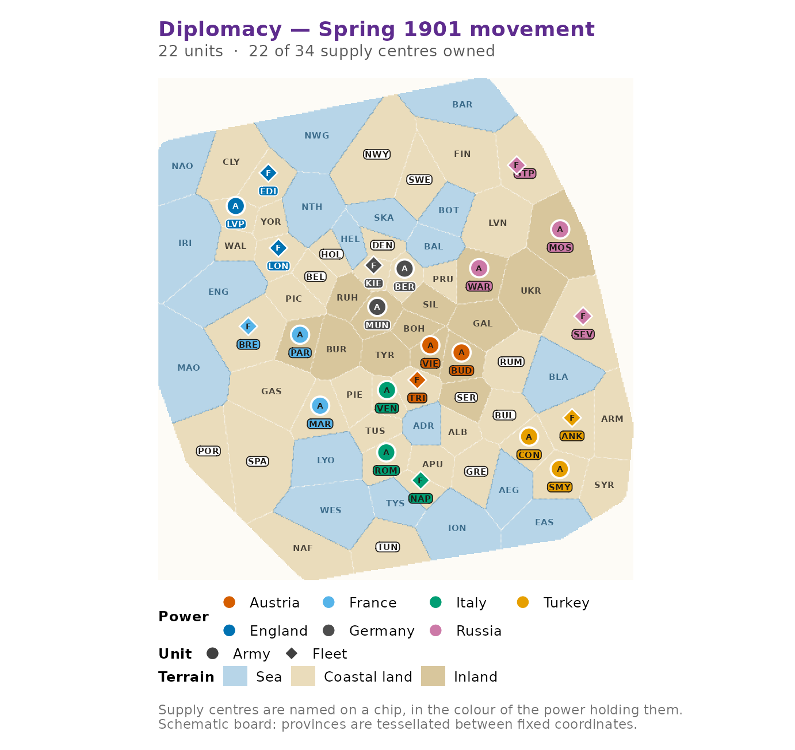

# Getting started with diplomacyR

Diplomacy is a game of negotiation played on a map of Europe as it stood
before the First World War. Seven Great Powers share 75 provinces, 34 of
which are supply centres; a power that comes to control 18 of those
centres wins outright. There are no dice. Every player writes orders for
every one of their units in secret, all the orders are revealed at once,
and a single set of rules decides what actually happened.

That last step is the hard part, and it is what this package is mostly
about. `diplomacyR` gives you the board, an adjudicator that resolves a
turn under the standard rules, a phase machine that carries a game from
Spring 1901 to its conclusion, a handful of bots, and the tools to
simulate and analyse many games at once.

``` r

library(diplomacyR)
```

## The board

[`dp_map()`](https://r-heller.github.io/diplomacyR/reference/dp_map.md)
loads the standard seven-power board. It is a validated object, not a
bare list: the province table, the army and fleet adjacency graphs, the
supply centres, the home centres and the canonical opening position all
travel together.

``` r

board <- dp_map()
board
#> <dp_map> "standard"
#> • 75 provinces (14 inland, 42 coastal, 19 sea)
#> • 34 supply centres, 22 starting units
#> • 7 powers: "Austria", "England", "France", "Germany", "Italy", "Russia", and
#>   "Turkey"
```

Provinces are addressed by three-letter codes.
[`dp_provinces()`](https://r-heller.github.io/diplomacyR/reference/dp_provinces.md)
lists them, optionally filtered by type.

``` r

head(dp_provinces(board, type = "sea"), 5)
#> # A tibble: 5 × 7
#>   code  name         type  supply_centre home_power     x     y
#>   <chr> <chr>        <chr> <lgl>         <chr>      <dbl> <dbl>
#> 1 adr   Adriatic Sea sea   FALSE         NA            47    48
#> 2 aeg   Aegean Sea   sea   FALSE         NA            59    41
#> 3 bal   Baltic Sea   sea   FALSE         NA            48    74
#> 4 bar   Barents Sea  sea   FALSE         NA            55    97
#> 5 bla   Black Sea    sea   FALSE         NA            65    55
```

Armies and fleets move on different graphs, so
[`dp_adjacent()`](https://r-heller.github.io/diplomacyR/reference/dp_adjacent.md)
needs to know which kind of unit is asking. An army in Paris may walk
into Burgundy; a fleet in Brest may not.

``` r

dp_adjacent(board, "par", "army")
#> [1] "bre" "bur" "gas" "pic"
dp_adjacent(board, "bre", "fleet")
#> [1] "eng" "gas" "mao" "pic"
```

## A new game

[`dp_new_game()`](https://r-heller.github.io/diplomacyR/reference/dp_new_game.md)
sets up Spring 1901 with the canonical 22-unit opening position and each
power owning its home centres.

``` r

game <- dp_new_game()
game
#> <dp_game> Spring 1901 (movement phase)
#> Russia    4 centres   4 units
#> Austria   3 centres   3 units
#> England   3 centres   3 units
#> France    3 centres   3 units
#> Germany   3 centres   3 units
#> Italy     3 centres   3 units
#> Turkey    3 centres   3 units
```

The units are a plain tibble, so anything you would normally do to a
data frame works.

``` r

dp_units(game, "France")
#> # A tibble: 3 × 4
#>   power  type  loc   province
#>   <chr>  <chr> <chr> <chr>   
#> 1 France fleet bre   bre     
#> 2 France army  mar   mar     
#> 3 France army  par   par
```

[`dp_power_counts()`](https://r-heller.github.io/diplomacyR/reference/dp_power_counts.md)
is the scoreboard: centres held, units on the board, and the difference
between them, which is what the winter adjustment phase acts on.

``` r

dp_power_counts(game)
#> # A tibble: 7 × 4
#>   power   centres units delta
#>   <chr>     <int> <int> <int>
#> 1 Russia        4     4     0
#> 2 Austria       3     3     0
#> 3 England       3     3     0
#> 4 France        3     3     0
#> 5 Germany       3     3     0
#> 6 Italy         3     3     0
#> 7 Turkey        3     3     0
```

## Looking at the board

[`dp_plot_map()`](https://r-heller.github.io/diplomacyR/reference/dp_plot_map.md)
draws a schematic board as a **ggplot2** object: seas in blue, land in
buff, every supply centre named on a chip in the colour of the power
that holds it, and each unit as an `A` or an `F` in its owner’s colour.
[`autoplot()`](https://ggplot2.tidyverse.org/reference/autoplot.html) on
a game does the same thing. The board is close to square, so give it a
close-to-square figure.

``` r

dp_plot_map(game)
```



The palette is colourblind-safe and available on its own as
[`dp_palette()`](https://r-heller.github.io/diplomacyR/reference/dp_palette.md),
so charts you build yourself can use the same colours.

## Writing orders

Orders can be written the way players write them.
[`dp_parse_orders()`](https://r-heller.github.io/diplomacyR/reference/dp_parse_orders.md)
reads standard notation and returns a `dp_orders` tibble.

``` r

french <- dp_parse_orders(c(
  "France: A Par - Bur",
  "France: A Mar - Spa",
  "France: F Bre - Mao"
))
french
#> <dp_orders> (3 orders)
#> France: A Par - Bur
#> France: A Mar - Spa
#> France: F Bre - Mao
```

The same orders can be built programmatically with
[`dp_order()`](https://r-heller.github.io/diplomacyR/reference/dp_order.md)
and stacked with
[`dp_bind_orders()`](https://r-heller.github.io/diplomacyR/reference/dp_bind_orders.md),
which is what you want when orders are generated rather than typed.

``` r

dp_bind_orders(
  dp_order("England", "move", "lon", target = "nth",
           unit_type = "fleet"),
  dp_order("England", "support", "edi", aux = c("lon", "nth"),
           unit_type = "fleet", aux_type = "fleet")
)
#> <dp_orders> (2 orders)
#> England: F Lon - Nth
#> England: F Edi S F Lon - Nth
```

Unit types are optional. They are only there to make an order readable;
the engine takes the real types from the board when it adjudicates.

If you are not sure what a unit may legally do, ask.
[`dp_legal_orders()`](https://r-heller.github.io/diplomacyR/reference/dp_legal_orders.md)
enumerates every order the rules allow a power to issue in the current
phase, convoyed moves included.

``` r

legal <- dp_legal_orders(game, "France")
table(legal$type)
#> 
#>    hold    move support 
#>       3      12      15
```

The full notation reference, including retreats, builds and the coast
qualifiers, lives in
[`vignette("notation")`](https://r-heller.github.io/diplomacyR/articles/notation.md).

## Adjudicating a turn

[`dp_adjudicate()`](https://r-heller.github.io/diplomacyR/reference/dp_adjudicate.md)
resolves a movement phase. It takes the game and the orders and returns
a `dp_result`.

``` r

orders <- dp_example_orders("spring_1901")
result <- dp_adjudicate(game, orders)
result
#> <dp_result> Spring 1901 (movement phase)
#> • 20 of 22 orders succeeded
#> • 0 units dislodged
#> • 1 province left contested
```

Two orders failed. [`summary()`](https://rdrr.io/r/base/summary.html) on
a result returns the effective orders with two extra columns: `success`,
which says whether the order achieved anything, and `note`, which says
how the engine treated the order in the first place.

``` r

resolved <- summary(result)
resolved[!resolved$success, c("power", "loc", "target", "success", "note")]
#> # A tibble: 2 × 5
#>   power  loc   target success note   
#>   <chr>  <chr> <chr>  <lgl>   <chr>  
#> 1 Russia sev   bla    FALSE   ordered
#> 2 Turkey ank   bla    FALSE   ordered
```

Both Russia and Turkey ordered a fleet into the Black Sea, neither had
support, and the two attacks cancelled. A province where a move bounced
is recorded as contested, which matters because dislodged units may not
retreat into it.

``` r

result$contested
#> [1] "bla"
```

Units that were not ordered, or whose order broke the rules, hold.
Nothing is ever rejected outright: an unparseable order is an error at
parse time, but an order that is merely illegal on the board becomes a
hold with a note.

## Advancing the game

A result does not change the game;
[`dp_advance()`](https://r-heller.github.io/diplomacyR/reference/dp_advance.md)
does. It applies the outcome, steps the season and phase machine,
recalculates supply-centre ownership when the year turns, and checks for
a solo victory.

``` r

game <- dp_advance(game, result)
game
#> <dp_game> Fall 1901 (movement phase)
#> Russia    4 centres   4 units
#> Austria   3 centres   3 units
#> England   3 centres   3 units
#> France    3 centres   3 units
#> Germany   3 centres   3 units
#> Italy     3 centres   3 units
#> Turkey    3 centres   3 units
```

Nothing was dislodged in the spring, so the retreat phase is skipped and
the game moves straight to the autumn.

## A full year

The autumn works the same way. This time the moves are contested, and
the autumn is the season in which supply centres change hands.

``` r

result <- dp_adjudicate(game, dp_example_orders("fall_1901"))
game <- dp_advance(game, result)
game
#> <dp_game> Winter 1901 (build phase)
#> France    6 centres   3 units
#> Russia    6 centres   4 units
#> Germany   5 centres   3 units
#> Austria   4 centres   3 units
#> England   4 centres   3 units
#> Italy     4 centres   3 units
#> Turkey    4 centres   3 units
```

Ownership has been recalculated on the way into the winter, so several
powers now own more centres than they have units and are owed builds.
The winter adjustment phase is resolved by
[`dp_build()`](https://r-heller.github.io/diplomacyR/reference/dp_build.md).

``` r

builds <- dp_parse_orders(
  c("France: Build A Par", "France: Build F Bre", "France: Build F Mar"),
  phase = "build"
)
result <- dp_build(game, builds)
summary(result)[, c("power", "type", "unit_type", "loc", "success", "note")]
#> # A tibble: 3 × 6
#>   power  type  unit_type loc   success note 
#>   <chr>  <chr> <chr>     <chr> <lgl>   <chr>
#> 1 France build army      par   TRUE    built
#> 2 France build fleet     bre   TRUE    built
#> 3 France build fleet     mar   TRUE    built
```

France ordered three builds and got three. Every other power is owed
builds too but ordered none, which is legal — an unused build is simply
forfeited for the year.

``` r

game <- dp_advance(game, result)
game
#> <dp_game> Spring 1902 (movement phase)
#> France    6 centres   6 units
#> Russia    6 centres   4 units
#> Germany   5 centres   3 units
#> Austria   4 centres   3 units
#> England   4 centres   3 units
#> Italy     4 centres   3 units
#> Turkey    4 centres   3 units
```

Spring 1902, and the game is ready for the next set of orders. The third
phase type, the retreat phase, is resolved by
[`dp_retreat()`](https://r-heller.github.io/diplomacyR/reference/dp_retreat.md);
it only appears in years where something was actually dislodged.

## Letting the engine play

Driving the three adjudicators by hand is useful when you care about a
particular position. When you do not,
[`dp_step()`](https://r-heller.github.io/diplomacyR/reference/dp_step.md)
resolves whatever phase the game is in and hands back the next state,
filling in orders for any power you did not order with a bot.

``` r

mine <- dp_parse_orders(c("France: A Par - Pic", "France: F Bre - Mao"))
dp_step(game, orders = mine, bots = "greedy")
#> <dp_game> Fall 1902 (movement phase)
#> France    6 centres   6 units
#> Russia    6 centres   4 units
#> Germany   5 centres   3 units
#> Austria   4 centres   3 units
#> England   4 centres   3 units
#> Italy     4 centres   3 units
#> Turkey    4 centres   3 units
```

Bots stand in for whole powers, not for individual units. France ordered
two of its six units here, so the other four held; the six other powers
were played by the greedy bot.

[`dp_play()`](https://r-heller.github.io/diplomacyR/reference/dp_play.md)
runs that loop until someone wins or the turn cap is reached, and
records every turn in a `dp_history`.

``` r

history <- dp_play(bots = "hold", max_years = 2, seed = 1)
history
#> <dp_history> (6 turns)
#> • From Spring 1901 to Winter 1902
#> • Outcome: "draw"
```

The history coerces to a tibble with one row per power per turn, which
is the natural input for a plot or a model.

``` r

head(as_tibble(history), 4)
#> # A tibble: 4 × 7
#>    turn season  year phase    power   centres units
#>   <int> <chr>  <int> <chr>    <chr>     <int> <int>
#> 1     1 Spring  1901 movement Russia        4     4
#> 2     1 Spring  1901 movement Austria       3     3
#> 3     1 Spring  1901 movement England       3     3
#> 4     1 Spring  1901 movement France        3     3
```

## Where to go next

- [`vignette("notation")`](https://r-heller.github.io/diplomacyR/articles/notation.md)
  — every order form the parser accepts.
- [`vignette("adjudication")`](https://r-heller.github.io/diplomacyR/articles/adjudication.md)
  — how the engine resolves a turn, worked position by worked position.
- [`vignette("ai-and-simulation")`](https://r-heller.github.io/diplomacyR/articles/ai-and-simulation.md)
  — the bots, batch simulation and the analysis plots.
- [`vignette("design")`](https://r-heller.github.io/diplomacyR/articles/design.md)
  — the S3 architecture and why the resolver works the way it does.

There is also a **shiny** application bundled with the package. It gives
you the board, an order editor that checks legality as you type, a turn
adjudicator, a replayable history and a simulation runner:

``` r

dp_run_app()
```
